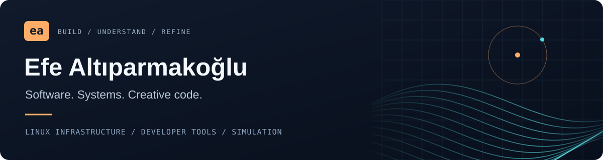
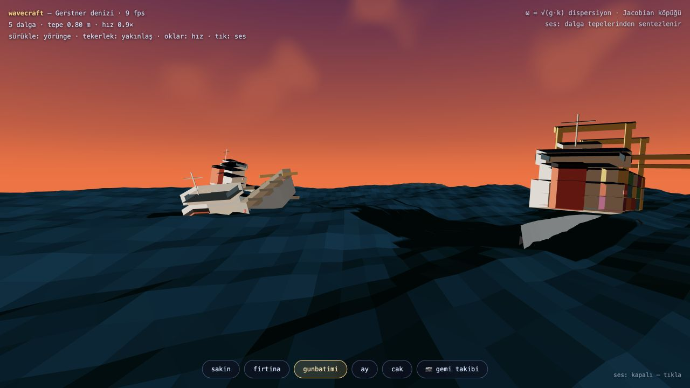
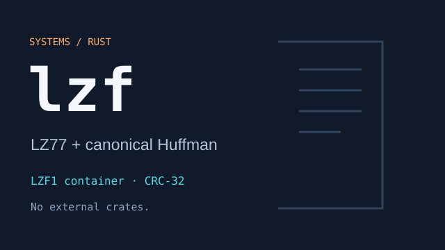

**English** · [Türkçe](docs/README.tr.md) · [Project catalog](PROJECTS.md) · [Cinema gallery](docs/cinema-gallery.md)

# Hi, I'm Efe.

I'm a software engineering student in Skopje and co-founder of [Bananas Hosting](https://bananashosting.com). My day-to-day work brings together Linux system administration, Python/PHP development, server infrastructure and customer needs. I also build developer tools and explore mathematics through graphics, motion and sound.

[Portfolio](https://efealtiparmakoglu.bananashosting.com) · [LinkedIn](https://www.linkedin.com/in/efealtiparmakoglu) · [Email](mailto:efealtiparmakoglu@bananashosting.com)

## What I build and operate

I co-founded **Bananas Hosting in 2023**. My role covers technical infrastructure, server management, customer relationships and growth strategy. Working on a service used by customers shapes how I approach software: understand the problem, make the system useful, and keep it maintainable.

| Focus | Work |
| --- | --- |
| Infrastructure | Linux system administration, hosting services and server operations |
| Software | Backend development and automation, with Python and PHP as core tools |
| Business | Turning technical needs into services, supporting customers and developing the company |

[More about my work and background →](https://efealtiparmakoglu.bananashosting.com)

## Start with something you can try

**[Launch Wavecraft →](https://efealtiparmakoglu.github.io/wavecraft/)** — a WebGL ocean with Gerstner waves and synthesized sea sound. Open it in your browser, choose a sea state and explore.

## Selected work

<table>
  <tr>
    <td width="50%" valign="top">
       
      <h3><a href="https://github.com/efealtiparmakoglu/wavecraft">wavecraft</a></h3>
      Interactive ocean / WebGL + Web Audio  
      An interactive ocean with sea sound synthesized from the wave field.
    </td>
    <td width="50%" valign="top">
       
      <h3><a href="https://github.com/efealtiparmakoglu/lzf">lzf</a></h3>
      File compression / Rust  
      LZ77 + Huffman, CRC-32 integrity checks and a custom LZF1 container.
    </td>
  </tr>
  <tr>
    <td width="50%" valign="top">
       
      <h3><a href="https://github.com/efealtiparmakoglu/silicon-cinema">silicon-cinema</a></h3>
      A computer from scratch / Python  
      A 32-bit CPU, assembler and CIN compiler; every pixel comes from its own programs.
    </td>
    <td width="50%" valign="top">
       
      <h3><a href="https://github.com/efealtiparmakoglu/blender-json-cinema">blender-json-cinema</a></h3>
      Procedural worlds / Blender  
      Terrain, atmosphere, lighting and camera motion from JSON parameters.
    </td>
  </tr>
  <tr>
    <td width="50%" valign="top">
       
      <h3><a href="https://github.com/efealtiparmakoglu/linkage-studio">linkage-studio</a></h3>
      Walking machines / Kinematics  
      A Blender add-on driven by a closed-form solution of the Jansen linkage.
        <a href="https://github.com/efealtiparmakoglu/linkage-studio/releases/latest/download/linkage_studio.zip">Download Blender add-on →</a>
    </td>
    <td width="50%" valign="top">
       
      <h3><a href="https://github.com/efealtiparmakoglu/gargantua-cinema">gargantua-cinema</a></h3>
      Black-hole lensing / Simulation  
      Light bending from Schwarzschild geodesics and a relativistic accretion disk.
    </td>
  </tr>
  <tr>
    <td width="50%" valign="top">
       
      <h3><a href="https://github.com/efealtiparmakoglu/lightning-cinema">lightning-cinema</a></h3>
      Lightning / Simulation  
      A stepped leader and return stroke from a dielectric-breakdown model; the scene is lit by the current itself.
    </td>
    <td width="50%" valign="top">
       
      <h3><a href="https://github.com/efealtiparmakoglu/chladni-cinema">chladni-cinema</a></h3>
      Chladni figures / Wave physics  
      Sand migrating to the nodal lines of a plate solved with a 2D wave equation.
    </td>
  </tr>
</table>

[Explore all public projects →](PROJECTS.md) · [Browse the full cinema gallery →](docs/cinema-gallery.md)

## What connects the projects

- **Systems:** Linux services, backend development, containers and practical automation.
- **Tools:** focused command-line utilities in Python, Rust and Go, often built with the standard library.
- **Creative computing:** rendering, emulators, numerical simulations and procedural animation.

I like projects where the mechanism is visible: a compiler you can follow, a codec you can inspect, or a scene whose motion comes from equations.

**The cinema series runs on one rule:** every claim has to pass a numerical gate. The physics is solved in plain Python, Blender only carries the solution, and nothing is eased by hand — a lightning bolt is a dielectric-breakdown model, sand on a plate is a wave equation, ferrofluid spikes are a magnetohydrodynamic instability.

## A short timeline

| Period | Milestone |
| --- | --- |
| 2019–2023 | TEV Orhan Çetin Science High School; early projects in mining and cryptography |
| 2023–2024 | First e-commerce venture, reaching 13 platforms |
| 2023–present | Co-founder of Bananas Hosting |
| Currently | Studying software engineering at Ss. Cyril and Methodius University in Skopje |

## Toolkit

| Area | Technologies |
| --- | --- |
| Infrastructure & backend | Linux · Docker · Nginx · PHP · shell |
| Developer tools & systems | Python · Rust · Go · C |
| Web & applications | TypeScript · JavaScript · Swift |
| Graphics & simulation | Blender · NumPy · WebGL · GLSL · Web Audio |

---

Studying software engineering at Ss. Cyril and Methodius University in Skopje. Building and operating Bananas Hosting since 2023.

**Let's connect:** [LinkedIn](https://www.linkedin.com/in/efealtiparmakoglu) · [Portfolio](https://efealtiparmakoglu.bananashosting.com)
